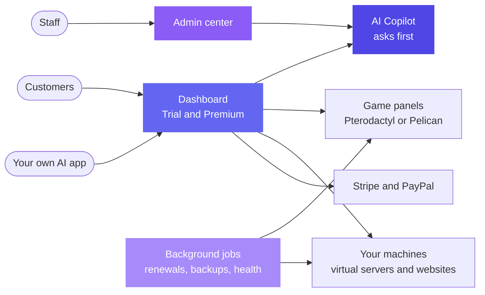
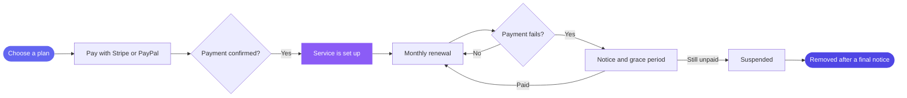

 

*Game servers, virtual servers and websites, with billing, community and an AI Copilot, all run from one dashboard.*

**Current version: `v4.7.0`** · [Release timeline](./VERSIONS.md)

---

> **A showcase repository.** It contains no source code, only a tour of what ZenixDash is and the experience it creates.
>
> 🌐 **See it live at [dash.zenix.sg](https://dash.zenix.sg).**

## What you get

**If you host with a ZenixDash service**, you get one sign-in for everything you run: game servers with a live console, files, backups and mod installs; virtual servers you can rebuild and back up; websites with HTTPS set up for you. Start in the free Trial workspace, paid for with coins you earn, or buy a plan in the Premium workspace. An AI Copilot can read your logs and fix things, and it always asks before it does anything you cannot undo.

**If you run the service**, you get the control panel behind it: plans and payments, invoices and tax, support tickets, moderation, health checks, guided upgrades and an admin Copilot. Each product and community feature is a switch, and many start switched off, so an install offers only what its operator chooses.

## How it fits together

## Game servers

Each server opens into one workspace, with its tabs grouped as Run, Change, Keep alive, Connect and Manage. ZenixDash works with Pterodactyl-compatible panels, and Pelican support can be switched on. Free and paid servers can live on separate panels.

| | Feature | What it does |
|---|---|---|
| 🚀 | **Create in moments** | Pick a game, and the dashboard finds free ports and shows the server straight away. When nodes are busy you see your place in the queue |
| 🖥️ | **Live console and power** | A real-time terminal with Start, Stop, Restart and Kill. View-only collaborators can watch but not type |
| 📈 | **Resources at a glance** | Live and historical CPU, RAM, disk and network, plus live status across your whole fleet in cards or a table |
| 📁 | **File manager** | Edit, upload, download, compress, extract and drag to move. Settings files open as simple forms, and you can pull files in from another host over SFTP or FTP |
| 🧩 | **Mods, plugins and modpacks** | One-step installs from Modrinth, and CurseForge modpacks once the operator adds a key |
| ⚙️ | **Startup and Minecraft setup** | A typed form for startup settings, a Minecraft EULA checkbox that lets the server start first time, and reinstall with a backup taken first |
| 💾 | **Backups and worlds** | Backups with a safety copy before every restore, an optional offsite copy, and a World tab to archive and restore your world |
| 🧬 | **Clone and split** | Copy a server into a new one, or split part of its resources into a second server and merge them back later |
| ⏰ | **Schedules** | Timed tasks, power schedules, and a traffic limit that can warn on Discord or stop the server |
| 🗄️ | **Databases** | Create MySQL databases, rotate passwords, import statements and edit single values |
| 🌐 | **Domains and networks** | Subdomains through Cloudflare, SFTP quick-connect, and a drag-and-drop canvas that wires servers into a BungeeCord, Velocity or Waterfall network |
| 🎮 | **Minecraft players** | Online players with health, XP and inventory, plus one-click OP, kick and ban |
| 🩺 | **Crashes and performance** | A crash log with the console lines from just before each crash, a plain-English cause when a crash repeats, and a profiler that reads tick history from the server's own log |
| 👥 | **Collaborators and history** | Invite people as Viewer or Manager, and see dashboard, crash and panel activity in one timeline |
| 🔗 | **Share and status pages** | A public page with your own link, a social preview image, live player count and copy-IP button, and a status page with 24-hour graphs |

## Virtual servers and websites

Both run on machines the operator adds to ZenixDash, with no separate hosting panel to connect.

| | Feature | What it does |
|---|---|---|
| ☁️ | **Virtual servers** | Create, rebuild, start, stop, reboot, suspend, resume and destroy. Log in with your SSH key, or with a root password that is stored encrypted once the operator sets a key |
| 💾 | **VPS backups** | Back up now or on a daily or weekly schedule. A restore keeps the same address |
| 🌍 | **IPv6 and reverse DNS** | An IPv6 address next to IPv4 where the operator offers one, and reverse DNS names you set yourself |
| 🤝 | **AI help over SSH** | Opt in per server, after a 10-second consent countdown. Choose one of three safety levels and revoke access at any time |
| 🔒 | **Websites with HTTPS** | A site on its own domain gets a certificate when it is created, and it renews itself |
| ⏪ | **Deploy and roll back** | Upload a new version, roll back in one click, and delete a site to clean up everything it used |
| 🧰 | **Machines for operators** | Add a machine over SSH, confirm its host key, and the agent installs itself. Address pools are managed in the same place, and a machine can be drained before it is retired |

## Plans, billing and credit

| | Feature | What it does |
|---|---|---|
| 🔀 | **Trial and Premium workspaces** | One switch in the header moves between the free Trial workspace and the paid Premium workspace |
| 🏷️ | **Fixed plans** | Clear plan cards with a name, price and specs for game servers, virtual servers and websites |
| 💳 | **Stripe checkout** | Your service is set up once payment is confirmed. See your plan, price and renewal date, and manage or cancel through the Stripe billing portal |
| 🅿️ | **PayPal subscriptions** | An alternative way to pay for a plan |
| 🧾 | **Invoices** | Numbered in order, showing the tax rate that applied and your company details, printable, and exportable as CSV |
| 💰 | **Zenix Credit** | A credit balance you can top up, with promotional credit spent first and a history you can export |
| ✅ | **Paid verification** | Optional: a one-time deposit that becomes credit, plus a promotional bonus. The operator sets both amounts |
| 🔔 | **Payment reminders** | If a payment fails you get notices and a grace period before anything is suspended or removed |
| 🧑‍💼 | **Deals arranged by hand** | Staff can set up a plan for a sale made outside checkout, with an end date |

### From checkout to renewal

## Free tier and coins

The Trial workspace runs on coins, so a free server stays free for as long as its owner keeps it renewed.

| | Feature | What it does |
|---|---|---|
| 🪙 | **Coins** | Free servers are billed monthly in coins by their size, and suspended servers are not billed. Spend coins on more RAM, disk or CPU |
| 📅 | **Renewals** | Renew from the dashboard or a renewal link, with a quick human check |
| 🎁 | **Daily rewards and quests** | Login streaks, quests and achievements |
| 💤 | **AFK earning** | Earn coins on a dedicated page at an ad level you choose. Ads stay on that page |
| 🤝 | **Referrals and gifts** | Coins for both sides of a referral, and coins you can send to other members |
| 🎟️ | **Codes and giveaways** | Redeem codes for coins or resources, and giveaways run by staff |
| 🔨 | **Auctions** | Open and blind bidding for server slots, resources or coins |
| 📣 | **Join for rewards** | Coins for joining a partner Discord server, checked with Discord |
| 🏆 | **Leaderboard** | Top members by coins and fleet size |
| ⚖️ | **Fair play** | Accounts that have not verified earn a share the operator sets, and a nightly scan flags linked accounts for staff to review |

## AI that asks first

| | Feature | What it does |
|---|---|---|
| 💬 | **AI Copilot** | A chat drawer that knows your servers. It reads logs and files, changes settings and schedules, controls power and links you to the right page |
| ✋ | **You approve what matters** | Every action is sorted as read, write or destructive. Destructive ones always wait for your click, and an approval covers only that exact action |
| 🔌 | **Connect your own AI app** | Manage your servers from any MCP-compatible AI app, with tokens that are read-only or can make changes, expire, and can be revoked. Destructive actions send you back to the dashboard to confirm |
| 👀 | **Persistent agent** | Opt in and it watches for crashes, outages, full disks, failed backups and renewals. It tells you, acts only where you allowed it, and remembers the notes you give it, which you can see and erase |
| 🩹 | **Crash help** | One click explains a crash from the console lines before it, and the Copilot can patch a single broken line in a config file |
| 🎫 | **Support agent** | Answers tickets straight away and, if you grant access, looks at your actual servers. It cannot take destructive actions. A connected Discord bot can offer the same help in chosen ticket categories |
| 📚 | **Wiki drafts** | Solved tickets become draft wiki articles for staff to review |
| 🎚️ | **Model tiers** | The operator chooses which members get which model tiers. A product that is switched off disappears from every AI tool too |

## Community and support

| | Feature | What it does |
|---|---|---|
| 📖 | **Community wiki** | Members write guides, staff approve them, and authors can earn coins |
| 🧱 | **Blueprint marketplace** | Publish a server's setup and world as a blueprint, sell it for coins, and deploy a purchase onto a fresh server |
| 📰 | **News** | Staff post announcements that appear on every dashboard |
| 🎫 | **Support tickets** | Attachments, priorities, assignees and staff-only notes, with optional mirroring to Discord |
| 🔔 | **Notifications** | A bell with unread count, per-category preferences, quiet hours and Discord messages for warnings and billing |
| 📊 | **Public status page** | Current status, 90 days of incidents, a feed you can subscribe to, and maintenance notices |

## Accounts and safety

| | Feature | What it does |
|---|---|---|
| 🔑 | **Sign-in** | Email and password with email verification, Discord login, and two-factor authentication with recovery codes |
| 🚪 | **Registration modes** | Open, invite-only or closed, with invite codes from staff |
| 💻 | **Sessions and data** | See and sign out your other sessions, download your account data, or delete your account |
| 🛂 | **Signup screening** | VPN and proxy checks, disposable email blocking, linked-account detection, and banned identities kept from signing up again |
| ⚖️ | **Moderation** | Bans with a reason, feature bans that remove only AI, tickets or community access, and staff roles with fine-grained permissions |
| 🔒 | **Encrypted secrets** | Panel, payment and provider credentials are encrypted at rest with the operator's own key |

## For operators

| | Feature | What it does |
|---|---|---|
| 🧭 | **Guided setup** | First run asks for a one-time token from the server console. No default passwords are shipped |
| 🎛️ | **Modules and switches** | Turn products and community features on or off for each install |
| 👤 | **Users and servers** | Manage accounts and servers, act on many at once, and step into a customer's view with an audit trail |
| 🗺️ | **Infrastructure** | Node heatmap, health checks, out-of-memory recovery, node migration and game imports |
| 🛠️ | **Operations center** | Integration health, alert thresholds, scheduled jobs with Run now, the creation queue, an incident timeline, and AI usage with a credit forecast |
| 📜 | **Audit log and analytics** | Filter the audit log and export it as CSV. Analytics cover signups, servers, resources, the economy and AI use |
| 🤖 | **Admin Copilot** | Fleet-wide AI tools for staff, kept apart from customer tools |
| ⬆️ | **Guided upgrades** | Staged builds with a snapshot, a health check and rollback, plus a maintenance switch |
| 💽 | **Platform backups** | Database backups to Google Drive, and backup and restore commands |
| 🔧 | **Bot API** | Tiered tokens with rate limits and expiry for Discord bots and scripts |

## Look and feel

| | Feature | What it does |
|---|---|---|
| 🎨 | **Make it yours** | Ten palettes, a choice of corner shapes, your own accent colour with contrast checked for you, and a solid, gradient or image background |
| 🧱 | **Rearrangeable home** | A main column and a side rail of widgets, arranged per device |
| 📱 | **Anywhere** | Works at phone width in light and dark mode, and installs as an app that offers updates |
| ⌨️ | **Command palette** | Press Ctrl+K to jump anywhere |
| 🌍 | **Languages** | A language picker, with English and a partial German translation. Anything untranslated shows in English |

## Works with

Pterodactyl and Pelican panels · Stripe · PayPal · Discord · Cloudflare · S3-compatible storage · Google Drive · Modrinth · CurseForge · OpenAI-compatible and Anthropic models · SMTP email

## Release history

ZenixDash grew from a simple server list into a hosting platform. The 4.7 line brought full virtual server and website hosting, invoices with tax and payment reminders, and AI you can connect to your own apps. See the [release timeline](./VERSIONS.md), newest first.

## Built with

Next.js and React, running as a single Node.js process with SQLite. The console uses xterm.js.

---

**ZenixDash** · crafted by [Zenix Developers](https://github.com/Zenix-Developers) · [zenix.sg](https://zenix.sg)

*The source code is private. Interested in a closer look? Get in touch.*

