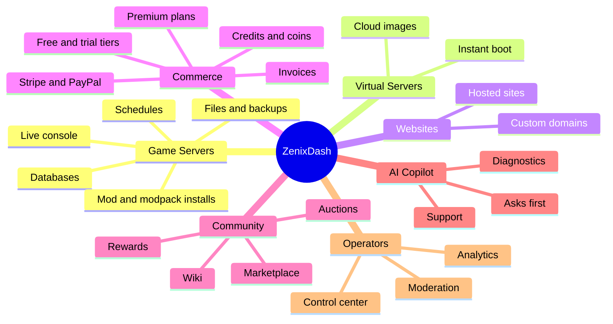
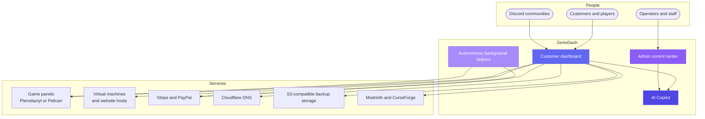
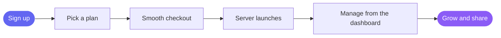
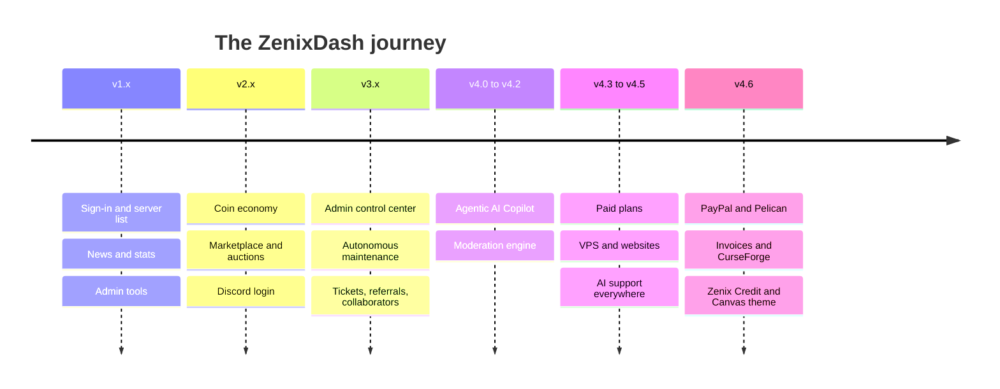

 

*Game servers, virtual servers and websites: launched, managed and loved from a single graceful dashboard.*

**Current version: `v4.6.6-pre`** · 52 versioned releases · [Full release timeline](./VERSIONS.md)

---

> **A showcase repository.** It contains no source code, only a tour of what ZenixDash is and the experience it creates.
>
> 🌐 **See it live at [dash.zenix.sg](https://dash.zenix.sg).**

## Contents

- [The idea](#the-idea)
- [How it fits together](#how-it-fits-together)
- [Game servers](#game-servers)
- [Plans, billing and credit](#plans-billing-and-credit)
- [Coin economy](#coin-economy)
- [Virtual servers and websites](#virtual-servers-and-websites)
- [Community](#community)
- [AI Copilot and automation](#ai-copilot-and-automation)
- [Support](#support)
- [Admin control center](#admin-control-center)
- [Moderation and safety](#moderation-and-safety)
- [Integrations](#integrations)
- [Look, feel and reach](#look-feel-and-reach)
- [Release history](#release-history)

## The idea

Running a hosting service should feel effortless, for the people who run it and the people who use it. ZenixDash brings every moving part together (servers, billing, support and community) into one calm, polished control plane, so you can spend your time growing instead of juggling tools.

It works with Pterodactyl-compatible panels (and optionally Pelican), takes real payments through Stripe and PayPal, rewards its community with a friendly coin economy, and puts an AI Copilot beside every customer and every operator, one that always asks before doing anything important.

## One dashboard, everything inside

## How it fits together

In plain terms: customers use one dashboard, the dashboard talks to your game panels, your virtual machines and your payment providers, and a set of quiet background helpers keeps everything tidy.

## From signup to running, in moments

---

## Game servers

Everything a player needs to run a server, in one tabbed workspace.

| Feature | What it feels like |
|---|---|
| **Templates and instant creation** | Deploy Minecraft, Rust, CS2 and more from customizable templates mapped to panel eggs, with sensible default resources |
| **Creation queue** | A friendly managed queue with a visible position, and an optional skip-the-line option |
| **Live console** | A real-time terminal with full input, plus Start, Stop, Restart and Kill power controls |
| **Persistent console stream** | One shared live connection per running server keeps stats, power state and a rolling console history instantly available |
| **Resource monitoring** | Live and historical CPU, RAM, disk and network graphs |
| **Fleet live view** | A single multiplexed stream powers live status dots and metrics across every server you own, with toasts for status and crash events |
| **File manager** | Browser-based read, write, upload, download, compress and decompress, with drag-to-move, SHA-256 viewing and field-style editing for env, ini, cfg, JSON and TOML files |
| **Import from another host** | Pull individual files from a public SFTP or FTP host straight into the current folder |
| **Databases** | Self-service MySQL creation and rotation, with statement import and single-cell edits |
| **Backups** | Create, download and restore, with optional S3-compatible offsite storage |
| **Schedules** | Cron-style tasks such as daily restarts and weekly backups |
| **Subdomains** | Cloudflare-powered custom subdomains assigned right from the dashboard, with a setup wizard and credential check |
| **SFTP quick-connect** | One-click credential copy and a ready-made `sftp://` link |
| **Startup variable editor** | A typed form for MOTD, seed, gamemode, JVM flags and other egg settings |
| **Reinstall and re-image** | Reinstall or switch Docker image, with an automatic backup taken first |
| **Traffic limit** | A megabytes-per-second cap with Discord notification and optional stop |
| **Allocations and notes** | See IP and port assignments, set display names, keep private notes |
| **Server groups and tags** | Organize a fleet your way |
| **Fleet table view** | A compact table of all your servers alongside the card view |
| **Mod and plugin installs** | One-step installs from Modrinth |
| **CurseForge modpacks** | Search, browse files and install server packs from CurseForge |
| **Player Live View (Minecraft)** | Online players, health and XP, a visual inventory grid (hotbar, main, armor, offhand), item gifting templates and one-click OP, kick and ban |
| **Proxy network linking** | A drag-and-drop canvas to wire servers into a BungeeCord, Velocity or Waterfall network, with the proxy config updated for you |
| **Crash intelligence** | Crashes are recognised and saved with the real console tail from just before they happened |
| **Proactive crash diagnosis** | When a cause repeats, the dashboard states what is wrong and what to do about it, in plain English |
| **Per-server activity timeline** | One chronological History tab merging dashboard events, crash events and panel activity |
| **Collaborators** | Invite teammates as Viewer (read-only) or Manager (read and write) |
| **Public status pages** | Shareable status pages with custom slugs, 24-hour CPU and RAM graphs and uptime |
| **Server share cards** | Public server pages with custom slugs, social preview images, live metrics and a copy-IP button |
| **Panel flexibility** | Works with Pterodactyl-compatible panels, with optional Pelican Panel support |
| **Panel import and node migration** | Sync users and servers from the panel and move live servers between nodes with a guided wizard |

## Plans, billing and credit

Real-money hosting that feels as simple as the free tier.

| Feature | What it feels like |
|---|---|
| **Free and Premium tiers** | A header toggle switches the whole dashboard between free and premium views |
| **Dual-panel architecture** | Free servers and paid servers can live on separate panels, so premium customers get premium hardware |
| **Fixed-spec plan cards** | Clear, non-editable plans with a name, price and specs, shown in the shop and in the create flow |
| **Stripe Checkout** | Hosted checkout with servers provisioned as soon as payment is confirmed |
| **PayPal Checkout and billing** | PayPal subscriptions for customers who prefer it, treated just like Stripe through renewals and lifecycle |
| **Invoices and billing history** | Sequential, auditor-friendly invoice numbers, printable detail views and a record of exactly what was charged |
| **Billing page** | Tier, promotional versus purchased credit, free services, paid plans and how to cancel, all in one place |
| **Self-service plan management** | Customers see their plan, price and renewal date, and can reach the Stripe billing portal |
| **Zenix Credit** | A ledger-backed credit balance with a top-up card, promotional credit used first |
| **Verification tier** | An optional paid verification that grants credit, with operator-chosen amounts |
| **Graceful payment lifecycle** | A grace period, then suspension, then cleanup, applied consistently to game servers, virtual servers and websites |
| **Manual onboarding** | Admins can deploy a plan directly for invoice or Discord-style sales |
| **Admin payment settings** | Stripe and PayPal credentials stored encrypted, with a live connection test |
| **Coupons** | Discount codes for plans |

## Coin economy

A playful currency that keeps the free tier lively.

| Feature | What it feels like |
|---|---|
| **Coins** | The friendly currency for renewals, upgrades and the marketplace |
| **Hybrid billing** | Servers are billed by their deployed resources, and only while running |
| **Gentle suspension cycle** | A grace window, then suspension, then automated cleanup to free capacity |
| **AFK earning** | Earn coins by relaxing on a dedicated page, with selectable ad levels, kept off the rest of the dashboard |
| **Virtual shop** | Spend coins to raise RAM, disk or CPU limits |
| **Redeem codes** | Single-use or multi-use codes for coins or resource boosts |
| **Quests and daily rewards** | Daily claims, achievements and login streaks |
| **Referrals** | Both the referrer and the new member receive bonus coins |
| **Gifting** | Send coins to other members, with an optional small fee and an admin switch |
| **Join for Rewards** | Earn coins for joining a partner Discord server, verified with Discord |
| **Auctions** | Premium blind bidding and standard auctions on exclusive resources and pre-built servers |
| **Leaderboard** | A global ranking by coins and fleet size |
| **Transaction history** | A clear record of every coin earned and spent |

## Virtual servers and websites

| Feature | What it feels like |
|---|---|
| **Virtual servers** | A cloud-image guest created by the dashboard itself: it copies the image, takes an address from the pool and boots with cloud-init |
| **One-time root password reveal** | The root password is shown once the server is running |
| **Machine management** | Operators add machines over SSH, confirm the host key and the node agent is installed for them |
| **Websites** | Website hosting on the same machines, managed beside everything else |
| **Free websites** | Optionally give free accounts a website allowance, with a named plan and per-account limit |
| **Paid VPS and hosting plans** | Same Stripe and PayPal checkout and lifecycle as paid game servers |
| **Provisioning timelines** | Customers see a step-by-step timeline of what is happening with a new product |
| **Provider cells and module registry** | Operators choose which products are offered and when they appear to customers |

## Community

| Feature | What it feels like |
|---|---|
| **Community wiki** | Members submit Markdown guides, staff approve them, authors can earn coins, and a "My submissions" page tracks progress |
| **AI wiki auto-writer** | Solved support tickets are turned into draft wiki articles |
| **Blueprint marketplace** | Publish a server's configuration and world as a blueprint, sell it for coins, deploy a purchase on a fresh server |
| **Design studio** | An optional admin-enabled studio for design tweaks |
| **News** | A WYSIWYG editor for announcements on every dashboard |
| **Optional landing page** | A marketing page with hero, feature grid and sign-up call to action |

## AI Copilot and automation

| Feature | What it feels like |
|---|---|
| **Agentic Copilot** | A draggable chat drawer that greets you with context about your fleet and can act on your behalf |
| **Ask-first safety** | Every action is classified as read, write or destructive, and destructive ones always need your explicit approval |
| **Rich toolset** | Files, console, power, startup variables, schedules, templates, renewals, fleet health summaries and links to the right pages |
| **Auto-Fixer** | Surgical edits to JSON, YAML and properties files to rescue crash loops without rewriting whole files |
| **AI Crash Analyzer** | One click turns the real pre-crash console tail into a formatted explanation right in the terminal |
| **Proactive nudges** | Opt-in notices for crashes, health, resource and renewals, behind a clear first-run disclosure |
| **Virtual server SSH access** | Opt-in, per-server access with a consent countdown, three safety tiers and instant revocation |
| **Admin God Mode** | A separate admin-only toolset for fleet-wide visibility and actions, including revenue summaries and user management |
| **Model discovery** | Admins pick the AI model from the provider's real list |
| **Viewer-aware** | Collaborators with view access get the same read-only boundary through the AI |
| **Feature-aware** | Turning a product off removes it from the AI everywhere |
| **Operations intelligence** | Daily briefings, incident bundles, drift detection and capacity forecasts for operators |
| **Autonomous maintenance** | Renewals, queues and cleanup run on their own, with no external scheduler needed |
| **Health checks and OOM monitor** | Node latency tracking and automatic recovery for memory-limit crashes |

## Support

| Feature | What it feels like |
|---|---|
| **Support tickets** | Customers file tickets (with attachments), staff reply, and Discord channels can mirror new activity |
| **AI ticket agent** | Replies instantly with contextual help and, with the customer's opt-in grant, investigates their real servers |
| **Discord ticket-scoped AI support** | Inside approved ticket categories, linked members can ask the AI about their services in plain language |
| **Bot API** | Structured endpoints for logs, files, config and fixes, with tiered tokens (Free, Premium, Admin) and rate limits |
| **In-app admin documentation** | A tabbed guide to moderation, billing, integrations and upgrades |

## Admin control center

| Feature | What it feels like |
|---|---|
| **Four-pillar navigation** | Dashboard, Infrastructure, Community and Economy, System Control, plus a global admin search |
| **Users and servers** | Full management, bulk actions, balance adjustments and password resets |
| **Impersonation** | Step into a customer's view to help, with an audit trail |
| **Roles and subadmins** | Fine-grained permission flags for tiered staff |
| **Node heatmap** | CPU, RAM and disk utilization across every node at a glance |
| **Analytics** | An eight-tab visualizer for signups, fleet, revenue, game distribution and economy |
| **Operations Center** | Integration health cards, cron and queue monitoring, live refresh and a rolling history |
| **Health and incident dashboard** | A single place to see how the platform is doing |
| **Audit log** | A searchable record of what happened and who did it |
| **Queue and cron views** | See the creation queue and when each background job last ran |
| **Pricing controls** | Set coin prices, manage giveaways, codes and auctions |
| **Feature toggles and module registry** | Switch products and community features on or off per install |
| **Settings manager** | A GUI for email, panel credentials, storage, ad providers, payments and queue limits |
| **Maintenance mode** | A global switch for smooth upgrades |
| **Guided upgrades** | A step-by-step upgrade flow with snapshots, health checks and a clear summary of what changes |
| **Database backups** | Google Drive backups with checksums, staged restore and recovery copies |
| **Guided first-run setup** | From a fresh install to a running service in minutes |
| **External status API** | Let a sister site or billing portal check an account's standing |
| **Notification test bench** | Preview and test the alerts your members receive |

## Moderation and safety

| Feature | What it feels like |
|---|---|
| **Moderation engine** | Global bans with a custom reason, plus feature bans that restrict only AI, tickets or community |
| **Alt and VPN screening** | A connection quality grader, alt-account detection from IP history and one-time bypass tokens for trusted members |
| **Email domain policy** | Block disposable email providers, with allow and block lists |
| **Banned identity vault** | Keeps banned identities from simply re-registering |
| **Sign-in options** | Email and password, Discord login and two-factor authentication with recovery codes |
| **Session management** | See and revoke your active sessions |
| **Encrypted credentials** | Panel, payment and provider keys are stored encrypted |
| **AI honeypot** | Attempts to trick the AI into admin tools are rejected and reported to staff |

## Integrations

| Integration | What it brings |
|---|---|
| **Stripe** | Hosted checkout, subscriptions and the billing portal |
| **PayPal** | Subscriptions and webhook-verified provisioning |
| **Pterodactyl and Pelican** | Game server management on compatible panels |
| **Discord** | Login, webhooks, DMs for warnings and billing notices, live status board, support, join rewards |
| **Cloudflare** | Automatic subdomains for servers |
| **S3-compatible storage** | Offsite backups |
| **Google Drive** | Platform backups and marketplace downloads |
| **Modrinth and CurseForge** | Mods, plugins and modpacks |
| **OpenAI-compatible and Anthropic models** | Power the Copilot, the ticket agent and the wiki writer |
| **Email providers** | Transactional email through SMTP |
| **Ad providers** | Optional ad-supported earning |

## Look, feel and reach

| Feature | What it feels like |
|---|---|
| **Themes** | Authentic, Minimalist, Signal, Canvas and a custom glassmorphic style |
| **Independent appearance axes** | Shape, accent and background chosen separately, with custom wallpapers and contrast-checked text |
| **Rearrangeable home** | A main column plus a side rail of widgets, placed per device |
| **Notifications** | Toasts and a notification center, per-category preferences and gentle "remind me later" countdowns |
| **Nine languages** | English, Deutsch, Français, Español, Português (Brasil), Nederlands, Polski, Türkçe and Русский, loaded lazily |
| **Installable app** | Progressive web app support with icons |
| **Accessible and responsive** | Designed for phones, tablets and desktops |

## Release history

ZenixDash has grown through **52 versioned releases**, from a simple server list to a full hosting platform. The current line is **`v4.6.6-pre`**. See the [full release timeline](./VERSIONS.md) for every release, newest first.

---

**ZenixDash** · crafted by [Zenix Developers](https://github.com/Zenix-Developers)

*The source code is private. Interested in a closer look? Get in touch.*

