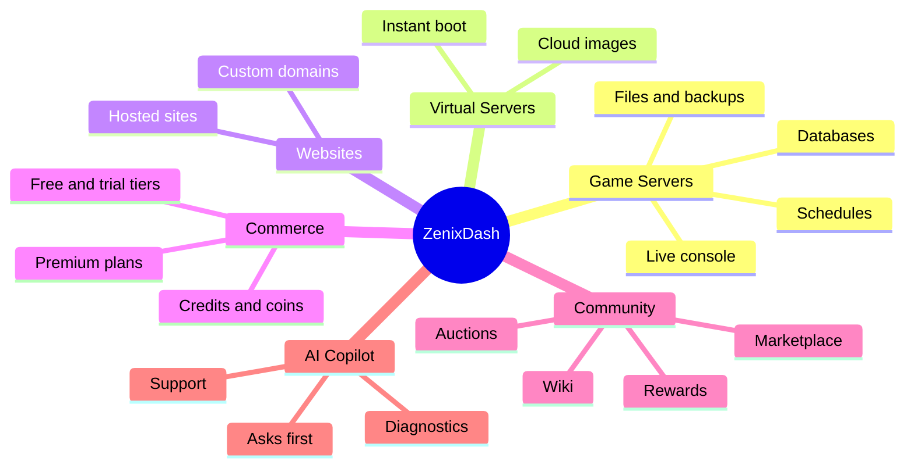
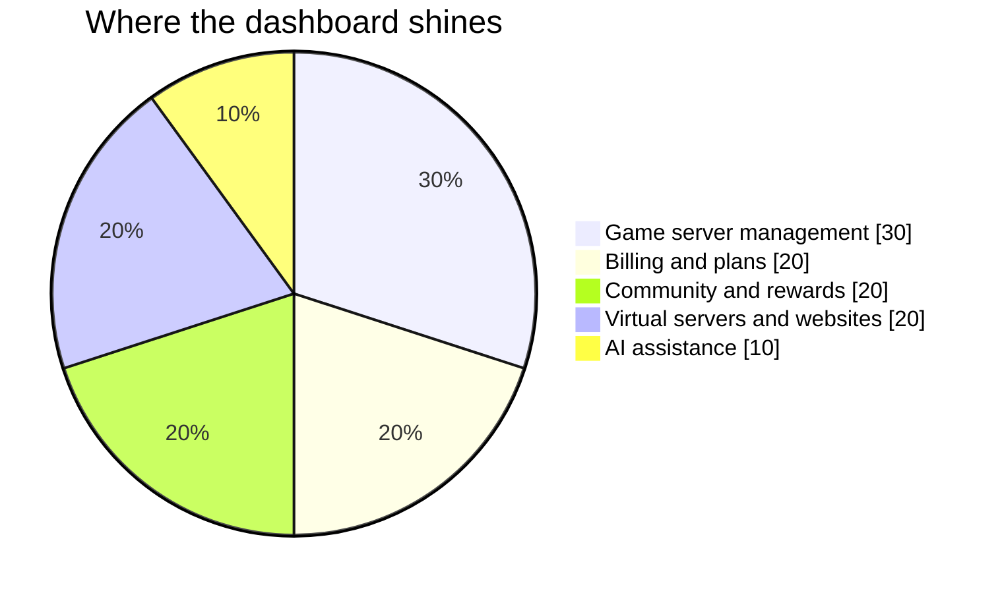

 

*Game servers, virtual servers and websites: launched, managed and loved from a single graceful dashboard.*

---

> **A showcase repository.** It contains no source code, only a tour of what ZenixDash is and the experience it creates.

## The idea

Running a hosting service should feel effortless, for the people who run it and the people who use it. ZenixDash brings every moving part together (servers, billing, support and community) into one calm, polished control plane, so you can spend your time growing instead of juggling tools.

## One dashboard, everything inside

## From signup to running, in moments

## For your players and customers

| | Feature | What it feels like |
|---|---|---|
| 🚀 | **Launch in moments** | A game server in a few clicks, with console, files, backups, schedules and databases at hand |
| 💎 | **Flexible plans** | Free and trial tiers, premium fixed-spec plans, smooth checkout, effortless renewals |
| ☁️ | **Virtual servers** | A cloud-image virtual server from the same familiar dashboard |
| 🌐 | **Websites** | Hosted sites managed right beside everything else |
| 🧩 | **Mods and plugins** | One-step installs from popular community catalogs |
| 🎮 | **Player tools** | Public share pages and activity timelines that make each server feel alive |
| 🏪 | **Community** | A shared wiki, blueprint marketplace, collaborators, rewards and auctions |
| 🤖 | **AI Copilot** | Plain-language help that always asks before doing anything important |

## For the people who run it

| | Feature | What it feels like |
|---|---|---|
| 📊 | **One operator view** | Customers, servers, billing and integration health together |
| 🪙 | **Credits and coins** | Friendly, rewarding pricing |
| 🎨 | **Your brand** | Appearance controls so the dashboard looks like you |
| 🧭 | **Guided setup** | From a fresh install to a running service in minutes |
| 🧾 | **Tidy audit trails** | Clear records of what happened and who did it |

## Experience at a glance

*An illustration of where the product puts its emphasis, not usage statistics.*

---

**ZenixDash** · crafted by [Zenix Developers](https://github.com/Zenix-Developers)

*The source code is private. Interested in a closer look? Get in touch.*

