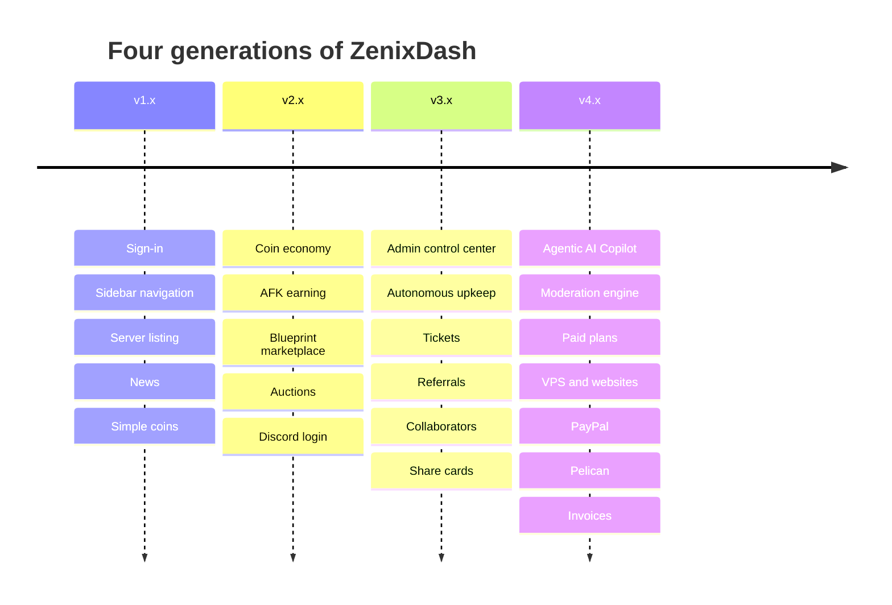
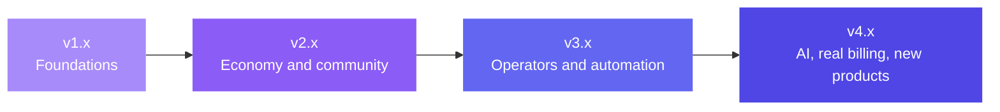

# ZenixDash Release Timeline

[Back to the overview](./README.md)

**Current version: `v4.6.6-pre`**

ZenixDash has arrived through **52 versioned releases** across four generations. This page lists them newest first, each framed around what it brought to the dashboard. The earliest generations (v1.x to v3.1) are a retrospective sketch of the platform's origins, and the generations from v3.2 onward trace the platform as it matured.

## Quick index

| Generation | Releases | Theme |
|---|---|---|
| v4.x | 19 | AI Copilot, moderation, paid plans, VPS and websites, PayPal, Pelican, invoices |
| v3.x | 18 | Admin control center, autonomous upkeep, community and support tools |
| v2.x | 10 | Coin economy, marketplace, auctions |
| v1.x | 5 | Foundations |

---

## Latest additions on the current line

- **Virtual servers (October 2026):** a new virtual server copies a cloud image, takes an address from the pool managed in the admin Machines page and boots with cloud-init. The root password is revealed once the server is running, and queued paid checkouts glide through provisioning.
- **Direction B design pass (September 2026):** a refreshed visual direction now spans the customer, premium, admin, hosting, billing, server-tab, public and Copilot surfaces, with clear shared status wording and tidy "queued" and "unavailable" states.
- **Game server provisioning polish:** server creation is more graceful when a panel is slow to answer, power actions wait politely while a server installs or transfers, newer and custom Minecraft Java images are preserved, and Minecraft EULA acceptance is explicit.

---

## v4.x: AI, real-money billing and new products

### v4.6 line: every currency, every panel, every language

- **v4.6.6-pre (current):** Auctions and the paid verification tier are paired, with operator-chosen verification amounts. Free accounts can be offered websites as well as game servers, each behind its own toggle with a named plan and per-account allowance. Every account gets a **Billing page** showing its tier, promotional and purchased credit side by side, free services, paid plans with their cancel path, and a delete-account option. Plus broad polish and reliability improvements across usage metering, renewals, status pages and auctions.
- **v4.6.5-pre:** Polish and reliability across panel integration and power schedules.
- **v4.6.4-pre:** A wide polish sweep across tickets, billing, auth, servers, admin, notifications, upgrades, domains, imports, scheduled jobs, appearance, plans, modules, moderation, setup, coupons, analytics, share cards and scheduled tasks.
- **v4.6.3-pre:** Reliability polish across fourteen surfaces, with stronger verification behind the scenes.
- **v4.6.2-pre:** **Zenix Credit** arrives: a ledger-backed balance with a verification deposit that becomes credit plus a promotional grant, spent promotional-first. **Join for Rewards** pays coins for joining partner Discord servers. Paid customers can see, manage and cancel their own plan. Signup and login screening gains a second signal. The front end blossoms: the **Canvas** theme, independent shape, accent and background axes, custom wallpapers, contrast-checked accent text, a rearrangeable dashboard home with a side rail and per-device widgets, a fleet table view for servers, and container-aware stat cards.
- **v4.6.1-pre:** A polish pass across the interface and billing displays, with sturdier development and rendering behavior.
- **v4.6.0 (major):** Six headline arrivals. **PayPal Checkout and Billing** for international audiences. **Pelican Panel support** as an operator-enabled option. **Invoices and billing history** with sequential numbering. **CurseForge modpack installs**. **Proactive AI diagnosis** that explains repeating crash causes in plain English. **Internationalisation**, with nine languages and graceful English fallback.

### v4.4 to v4.5 line: the Copilot gets hands

- **v4.5.1:** Polish for Discord ticket-scoped AI support, with identity and category checks on every call.
- **v4.5.0:** **Discord ticket-scoped AI support**, **AI tool feature-toggle awareness** (disabled products vanish from every AI surface), **AI model discovery** (pick from the provider's real list), and a smarter safety classifier for virtual server SSH commands.
- **v4.4.3:** Polish for the new Admin God Mode visibility tools.
- **v4.4.2:** **Admin God Mode expands** with game-server suspend and resume, background job and queue status, MRR summaries, server listing, plan visibility toggles, user suspension, bans with reasons, unbans and more.
- **v4.4.1:** Polish and reliability for payment retries, grace-period status and AI tool ownership checks.
- **v4.4.0 (major):** **ZenNode VPS** and **ZenWeb Hosting** join as real-money products with Stripe Checkout and automatic provisioning, plus a grace, suspend and delete lifecycle for all three paid product lines. The Copilot gains opt-in **per-VPS SSH access** with a consent countdown and safety tiers, an expanded admin toolset, and an upgraded **agentic ticket responder**.

### v4.3 line: paid plans arrive

- **v4.3.1:** Polish and reliability for proxy linking, migration, suspension and scheduled tasks on paid servers.
- **v4.3.0 (major):** **Paid Plans** on a second premium panel, kept separate from the coin economy. Stripe-hosted checkout with confirmation-driven provisioning, a header **Free/Premium toggle**, a real plans shop, fixed-spec plan cards, the drag-and-drop **Proxy Network Linking** canvas, and smoother handling of simultaneous traffic.

### v4.0 to v4.2 line: the Copilot era

- **v4.2.0:** A polish and reliability pass across sign-in, billing and the AI subsystem.
- **v4.1.0 (major):** The **Moderation Engine** with granular role-based access for tiered subadmins, **Feature Bans** that restrict specific features while keeping billing active, a banned-identity vault, and an interactive five-tab **Admin Documentation** interface.
- **v4.0.1:** The **AI Wiki Auto-Writer** turns solved tickets into draft wiki articles.
- **v4.0.0 (major):** The **Agentic AI Copilot** in a snap-back chat drawer, the **AI Crash Analyzer** with real console-stream integration, the **Auto-Fixer**, **Admin God Mode**, an **AI ticket auto-responder** and **Minecraft Player Live View** with a visual inventory.

---

## v3.x: operators and automation

<strong>v3.17 down to v3.0 (18 releases)</strong>

- **v3.17.0:** Discord bot webhooks and DMs, an email domain classifier, a global maintenance mode, VPN bypass tokens, SFTP quick-connect, a startup variable editor and a reinstall flow with an automatic backup.
- **v3.16.0:** The persistent **console-stream manager**: one shared live connection per running server, an SSE relay with automatic fallback, and real pre-crash console tails for crash analysis.
- **v3.15.0:** **Redeem codes**, **quests and daily rewards**, and a "My Wiki Submissions" tracker.
- **v3.14.0:** **Collaborators** with role-based permissions, and **server share cards** with custom slugs, social preview images, live metrics and a copy-IP button.
- **v3.13.0:** A toggleable public **marketing landing page**.
- **v3.12.0:** The **gifting system** for member-to-member coin transfers.
- **v3.11.0:** The **support ticket system** with Discord webhook mirroring, and tiered **Bot API tokens**.
- **v3.10.0:** The **referral system** with dual rewards, and a skip-the-queue option.
- **v3.9.0:** Polish for live connections and nodes that are slow to respond.
- **v3.8.0:** Faster server list loading.
- **v3.7.0:** Refined notification modals.
- **v3.6.0:** Upgrade to Next.js 16.2 with Turbopack and tuned build configuration.
- **v3.5.0 (major):** **Fully autonomous background upkeep** with no external scheduler, a **Node Migration Wizard**, a **Wiki Review Queue**, and customizable notification preferences with exponential-decay "remind me later" countdowns.
- **v3.4.0:** Polish for collaborator invites and Discord login streaks.
- **v3.3.0:** Smoother out-of-memory monitoring during server boot.
- **v3.2.0 (major):** The consolidated four-pillar **Admin Control Center**, a real-time **node resource heatmap**, an eight-tab **analytics visualizer**, an IP connection grader, an alt-account detector, an automated OOM monitor and public **server status pages** with interactive graphs.
- **v3.1.0:** The **WYSIWYG news system**.
- **v3.0.0:** Next.js routing and component refactoring for the new generation.

---

## v2.x: economy and community

<strong>v2.9 down to v2.0 (10 releases)</strong>

- **v2.9.0:** Clean-up of older schemas ahead of the v3 generation.
- **v2.8.0:** Polished mobile layout for the leaderboard.
- **v2.7.0 (major):** The **Community Blueprint Marketplace**, **Auctions** (premium blind bidding and standard), a **Global Leaderboard** and **Discord OAuth login**.
- **v2.6.0:** Refined spacing on the shop page.
- **v2.5.0:** Smoother transaction list rendering.
- **v2.4.0:** Polish and reliability for news announcements and the coin ledger.
- **v2.3.0:** AFK earning continues smoothly when the tab is in the background.
- **v2.2.0:** The **AFK earning page** and **transaction history** logs.
- **v2.1.0 (major):** The **Coin Economy**, hybrid billing by deployed resources, an automated suspension and cleanup cycle, **S3 backup offloading** and **Cloudflare subdomain routing**.
- **v2.0.0:** Dependency refresh and database timeout configuration.

---

## v1.x: foundations

<strong>v1.4 down to v1.0 (5 releases)</strong>

- **v1.4.0:** A per-node hardware load view for CPU, RAM and disk.
- **v1.3.0:** A simple **coins** balance, the seed of the later economy.
- **v1.2.0:** Admin node-to-node server transfers and user account management.
- **v1.1.0:** Main dashboard content, stats cards and an admin-driven **news** panel.
- **v1.0.0:** Initial release with user sign-in, sidebar navigation and server listing.

---

[Back to the overview](./README.md)
