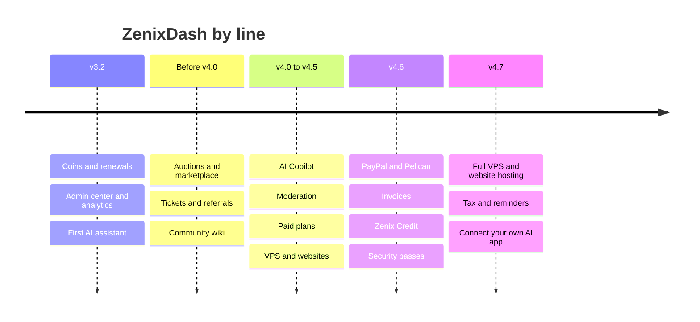

# ZenixDash Release Timeline

[Back to the overview](./README.md)

**Current version: `v4.7.0`**

Newest first, grouped by line. Dates come from the project history, which starts at v3.2 in June 2026. The v4.0 to v4.5 numbers were assigned shortly afterwards to group the July work, so treat them as approximate. Releases before v3.2 predate the tracked history and are summarised rather than listed.

## Quick index

| Line | When | What it brought |
|---|---|---|
| [v4.7](#v47-line-hosting-that-runs-on-real-machines) | October to November 2026 | Full virtual server and website hosting, billing with tax and reminders, MCP access, persistent agent |
| [v4.6](#v46-line-more-ways-to-pay-and-a-long-security-pass) | August to September 2026 | PayPal, Pelican, invoices, CurseForge, Zenix Credit, appearance options, security and reliability passes |
| [v4.0 to v4.5](#v40-to-v45-the-copilot-and-real-money-plans) | July 2026 | AI Copilot, moderation engine, paid plans, VPS and website products, AI support |
| [v3.2 and before](#v32-and-before-the-base) | Up to July 2026 | The coin-based free tier, the admin center, and the community and support tools |

---

## v4.7 line: hosting that runs on real machines

### Updates since v4.7.0 (October to November 2026)

These landed on the 4.7 line without a new version number.

- **Fair play on the free tier.** Daily rewards, quests and renewals ask for a quick human check, using a built-in captcha when no outside check is set up. Accounts that have not verified earn a share of rewards that the operator sets, and a nightly scan flags linked accounts for staff to review.
- **One consistent interface.** Buttons, status labels, tables, page headers, empty states and dates now look and behave the same everywhere.
- **AI model tiers.** Operators choose which members can use which model tiers, and the Copilot shows locked tiers clearly.
- **A redesigned Copilot.** The chat drawer became a full assistant panel.
- **Security reviews** of access control, input handling, sign-in and rate limits, plus fixes across suspension, provisioning, payments, setup, DNS and tickets.
- **For operators:** staff can set up a server for a paying subscription that has none, deals arranged by hand end on their date unless renewed, upgrades build the new release before switching to it, and there are database backup and restore commands.

### v4.7.0 (October 2026)

- **Virtual servers, end to end.** Add a machine over SSH and the agent installs itself. Customers can create, rebuild, suspend, resume and destroy servers, log in with an SSH key or a root password (stored encrypted once the operator sets an encryption key), back up on demand or on a schedule, restore at the same address, and use IPv6 and reverse DNS.
- **Websites.** A site on its own domain gets a certificate when it is created, and it renews itself, and each deploy can be rolled back in one click.
- **Game servers.** Free ports are picked automatically, a Minecraft EULA checkbox lets the server start first time, each server gets two backup slots with a safety copy before every restore, and the console and collaborator invites became reliable. New **Clone**, **World** and **Profiler** tabs, and a way to **split** part of a server's resources into a second server. Also new: Modrinth modpacks, a traffic limit, pulling files from another host over SFTP or FTP, and an operator page for adding games.
- **Your own backup storage.** Where the operator allows it, connect your own S3-compatible bucket or Google Drive for offsite backups.
- **Billing you can file.** Invoice numbers in order, tax rules, seller and customer details on every invoice, and reminders at each step when a payment fails.
- **Connect your own AI app** over MCP, with tokens that are read-only or can make changes. Destructive actions always come back to the dashboard to confirm.
- **Persistent agent.** An opt-in assistant that watches your servers and acts only where you allowed it.
- **Safer approvals.** An AI approval now covers only the exact action approved, and view-only collaborators stay read-only everywhere, including the console.
- **Accounts and operations.** Registration modes and invites, a sessions page, an audit log with CSV export, Run now for scheduled jobs, a status page feed, a notifications bell and an in-app update prompt.
- **A design refresh** across the customer, premium, admin, billing, public and Copilot screens.
- Before release, the product was checked live against real virtual machines, websites and game panels.

---

## v4.6 line: more ways to pay, and a long security pass

- **v4.6.6-pre (September 2026):** Security and reliability fixes across AI usage, ad rewards, checkout and server creation. Every stored credential is now encrypted at rest once the operator sets an encryption key.
- **v4.6.5-pre (September 2026):** Security and reliability fixes across panel keys, power schedules, collaborator access through the AI, and admin controls that reported success when an action had failed.
- **v4.6.4-pre (September 2026):** A security and reliability pass across tickets, billing, sign-in, servers, admin, notifications, upgrades, domains, imports, moderation and share cards.
- **v4.6.3-pre (September 2026):** A security and reliability pass across fourteen areas. New: paid verification amounts set by the operator, free websites alongside free game servers, and a **Billing page** for every account with a delete-account option.
- **v4.6.2-pre (September 2026):** **Zenix Credit**, a credit balance with promotional credit spent first. **Join for Rewards** pays coins for joining partner Discord servers. Paid customers can see, manage and cancel their own plan. Signup screening gains a second check. On the front end: the **Canvas** style, separate choices for shape, accent and background, custom wallpapers, a rearrangeable home with a side rail, and a table view for servers.
- **v4.6.1-pre (September 2026):** Interface and billing display fixes, including cost badges that now match what billing charges.
- **v4.6.0 (August 2026):** **PayPal** subscriptions, **Pelican** panel support as an option, **invoices and billing history**, **CurseForge** modpack installs, **plain-English crash diagnosis** for repeating crashes, and a **language picker** with English and a partial German translation.

---

## v4.0 to v4.5: the Copilot and real-money plans

All recorded in July 2026.

- **v4.5.1:** Fixes for Discord ticket-scoped AI support.
- **v4.5.0:** **AI support in Discord ticket categories**, AI tools that disappear when a product is switched off, model choice from the provider's real list, and a stricter safety check for AI commands on virtual servers.
- **v4.4.3:** Fixes for the new admin AI tools.
- **v4.4.2:** **More admin AI tools:** suspend and resume game servers, job and queue status, subscription summaries, plan visibility and account actions.
- **v4.4.1:** Fixes for payment retries, grace-period status and AI ownership checks.
- **v4.4.0:** **VPS and website hosting** as paid products with Stripe checkout and a grace, suspend and delete lifecycle. The Copilot gains opt-in **SSH access** to your own VPS with a consent countdown and safety levels, and the ticket agent can look at your servers once you grant access.
- **v4.3.1:** Fixes for proxy linking, migration, suspension and scheduled tasks on paid servers.
- **v4.3.0:** **Paid plans** on a separate premium panel, kept apart from the coin economy. Stripe checkout, the **Free and Premium switch** in the header, fixed-spec plan cards and the **proxy network** canvas.
- **v4.2.0:** Security and reliability fixes across sign-in, billing and the AI.
- **v4.1.0:** The **moderation engine**: staff roles with fine-grained permissions, feature bans, a banned-identity check at signup, and in-app admin documentation.
- **v4.0.1:** **Wiki drafts** written from solved tickets.
- **v4.0.0:** The first AI assistant becomes the **AI Copilot**: every action is sorted by risk, and destructive ones wait for your approval. Also new: the **crash analyzer**, the config **Auto-Fixer**, admin AI tools, an **AI ticket responder** and the **Minecraft players** view.

---

## v3.2 and before: the base

<strong>July 2026 back to v3.2</strong>

- **July 2026, before v4.0:** auctions, offsite backups to S3-compatible storage, quests, referrals with rewards on both sides, support tickets with Discord mirroring, coin gifting, an optional landing page, Cloudflare subdomains, the blueprint marketplace, the community wiki with a review queue, and one shared live console connection per running server. This work was numbered v3.3 to v3.17 afterwards.
- **v3.2 (June 2026):** the version the tracked history starts from. Sign-in with email, Discord and two-factor authentication. Game server creation with a queue. A coin economy with renewals, a shop and AFK earning. Redeem codes, news, a leaderboard, collaborators, share cards and public status pages. An admin area with a node heatmap, analytics, a server migration wizard, VPN bypass tokens, disposable email blocking, linked-account detection, out-of-memory monitoring, maintenance mode and Bot API tokens. A first AI assistant that could read the console and files, send commands and control power.
- **Before v3.2:** earlier versions predate the tracked history and are not listed.

---

[Back to the overview](./README.md)
